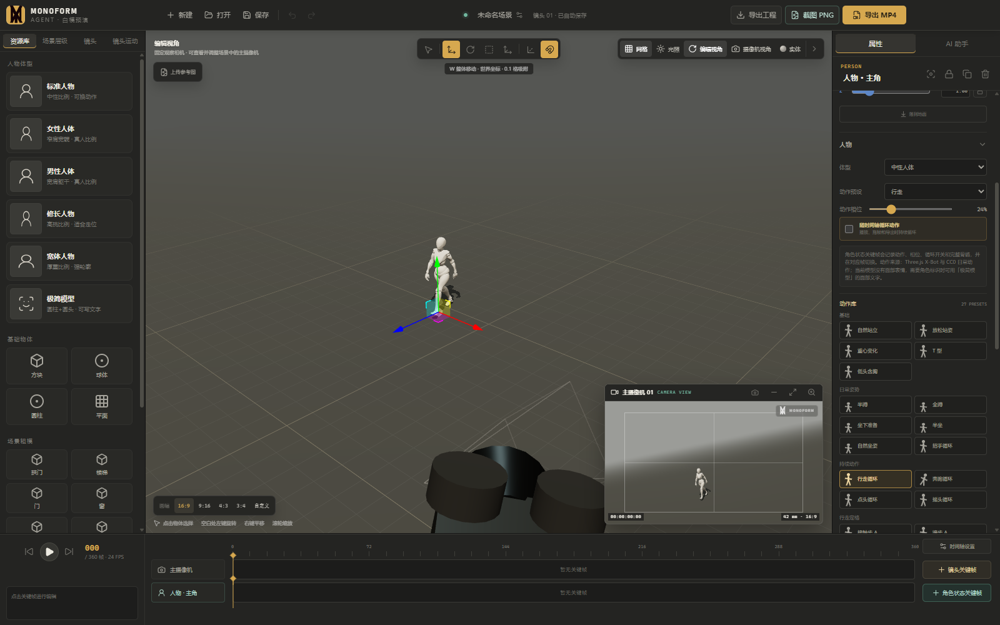
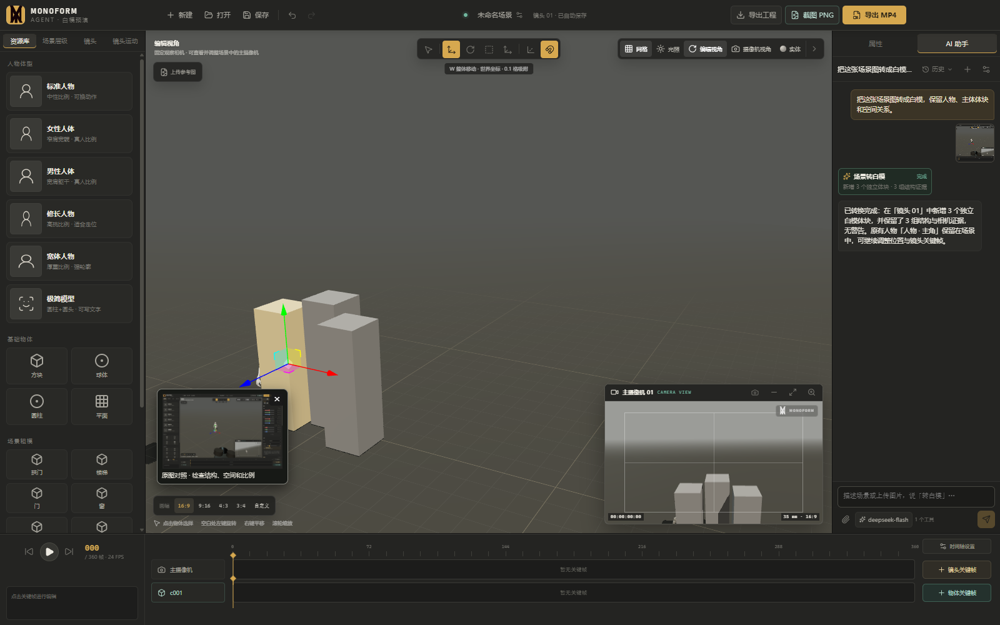
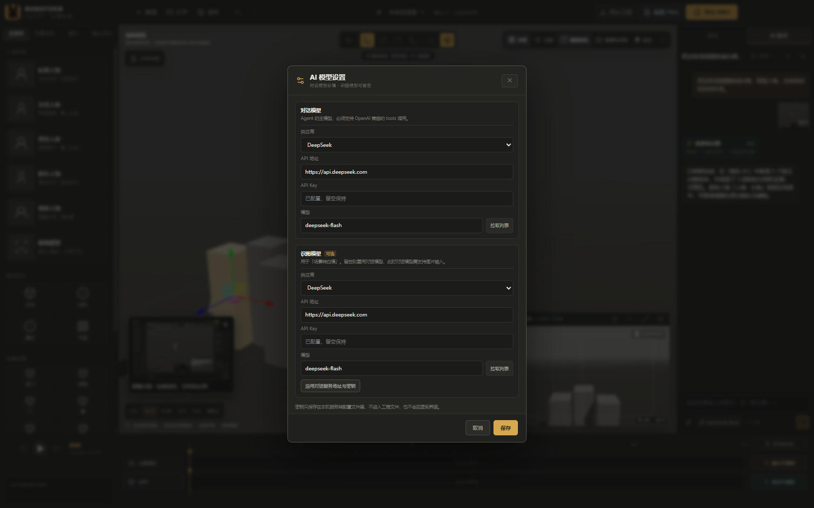
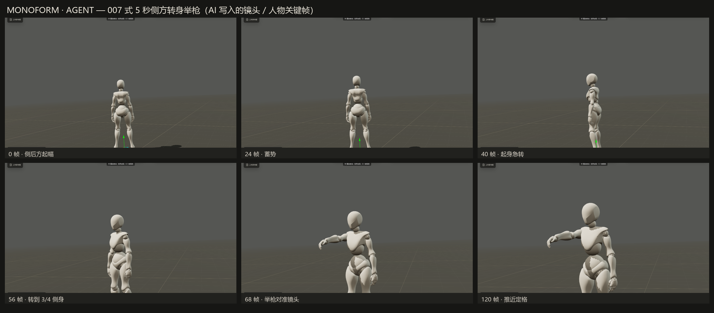
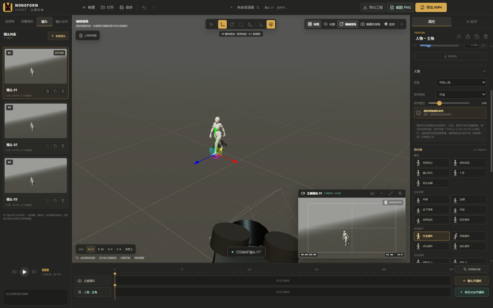
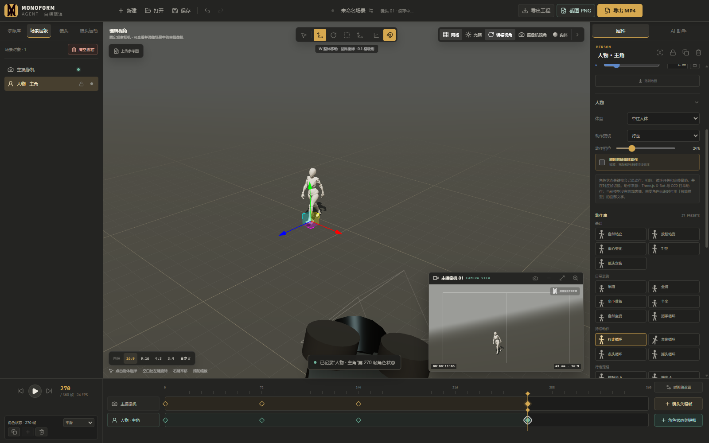

# MONOFORM · AGENT

> **原仓库说明**：原仓库地址：https://github.com/GuiYi-Xi/monoform-previs-studio。

MONOFORM · AGENT 是一款面向分镜、构图和镜头预演的轻量三维白模工作台。它提供 Electron 桌面应用，同时保留可直接部署到 GitHub Pages 的浏览器版本；可搭建场景、摆放带骨骼人物、管理多个独立镜头、制作人物与摄像机关键帧，并导出 PNG、MP4 或可迁移的工程 JSON。

## 相对原项目的升级

本仓库在原 MONOFORM 的基础上做了面向 agent 与桌面交付的升级：

- **Agent 聊天**：右侧新增「AI 助手」tab，支持流式对话、停止生成、附件预览、会话历史（SQLite）与删除二次确认；对话/识图两套模型配置，内置常见 OpenAI 兼容供应商预设。
- **对话构建场景**：通过默认工具 `scene_to_white_model`，把聊天里附上的场景参考图转成可编辑白模体块并追加到当前镜头；结果可撤销，也会随工程自动保存。
- **预演视频**：保留多镜头、摄像机与人物双轨关键帧、跟随镜头和镜头运动，导出 PNG、MP4 预演视频或工程 JSON；桌面版提供 Electron 窗口和 Windows 安装包。

## 产品概览

- **用户问题**：分镜创作者需要快速验证构图、机位和人物动作，但传统三维工具学习成本高，二维草图又难以重复调整镜头参数。
- **产品方案**：在桌面端和浏览器中提供轻量场景搭建、人物骨骼、参考图、多镜头、摄像机参数、跟随镜头、路径动画和多轨关键帧，把预演流程压缩到一个工作台。
- **我的工作**：负责需求与功能规划、交互和视觉设计、Three.js/React 实现、人物与摄像机工作流、导出能力、在线发布、测试和教程。
- **验证结果**：提供可直接使用的 GitHub Pages 在线版、完整源码和界面截图。

MONOFORM · AGENT 不把生成式 AI 当作最终成片工具。可选的本地 AI 服务负责两件事：把参考图转成可编辑白模场景，以及提供右侧「AI 助手」的对话入口（会话、工具调用、历史记录）。导入后仍由用户检查、调整和决定镜头。模型地址、模型名和 API 密钥只保存在本机配置中，不写入工程仓库；会话保存在本机 SQLite，不上传。

## 桌面版下载

[下载 MONOFORM · AGENT v0.6.0 Windows 安装包](<downloads/MONOFORM-0.6.0-win-x64-setup.exe>)（Windows 10/11 x64，约 93 MB）

安装包已随仓库提交，可直接点击下载；SHA-256 校验值见 [downloads/SHA256SUMS.txt](downloads/SHA256SUMS.txt)。

> 安装包未做代码签名，Windows SmartScreen 可能提示“未知发布者”，选择“更多信息 → 仍要运行”即可；安装位置和是否创建桌面快捷方式可在安装向导中调整。

## 界面说明

- 左侧「资源库」：添加人物、基础几何体、拱门、楼梯、门窗、家具、树木、车辆等场景粗模，或导入 GLB / GLTF 模型。
- 右侧「AI 助手」：桌面版会自动启动本机 AI 服务；配置对话模型后可与场景对话、查看/切换会话历史，并通过默认工具把上传的场景图转成可编辑白模。浏览器版需要先运行 `npm run server`。
- 左侧「场景层级」：选择、显隐、锁定场景物体；选中后可在右侧重命名、复制、删除或聚焦。
- 左侧「镜头」：新建、复制、重命名、删除和切换镜头，并显示真实摄像机缩略图。
- 中央「透视视图」：搭建三维场景、选择物体、调整观察角度，也可叠加一张动作或构图参考图。
- 右下「摄像机 01」：实时显示最终镜头画面，构图和焦距以这里为准。
- 右侧「属性」面板：编辑位置、旋转、缩放、人物动作、骨骼、颜色和摄像机参数；X/Y/Z 支持数值输入、逐轴锁定和归零，分组标题可收起。它与「AI 助手」共用右侧栏，顶部 tab 切换。
- 底部「时间轴」：分别记录摄像机与当前物体的关键帧。
- 视口「路线绘制」：在地面上拖出人物路线，自动生成带朝向的角色关键帧；路线关键帧与手动关键帧分开管理。
- 时间轴右侧「时间轴设置」：设置 24 / 25 / 30 FPS、1–60 秒关键帧条时长和循环播放；新建镜头默认 15 秒。

## 使用方式

### 1. 搭建场景

1. 在左侧点击一种「人物体型」，人物会加入场景并自动选中。
2. 点击「方块、球体、圆柱、平面」添加基础物体，也可直接添加拱门、楼梯、门窗、桌椅、沙发、屋顶、树木和车辆粗模。
3. 如果已有白模文件，点击「导入 GLB / GLTF」。单文件 `.glb` 的兼容性最好。
4. 选中物体后使用坐标轴拖动，也可以在右侧用 X / Y / Z 滑块或数值框调整位置、旋转和缩放；每个轴可以单独锁定，标题右侧的「归零 / 归一」按整组复位。
5. 按 `F` 或点击属性面板中的聚焦按钮，可快速把透视视图对准所选物体；锁定后空间变换会被禁用，避免误操作。
6. 在 `W` / `E` / `R` 变换模式下，当前对象会保持锁定，不会在拖动时被重叠模型抢选；按 `Q` 后可切换对象，重叠区域优先当前对象，按住 `Alt` 点击可选择前层模型。

常用变换快捷键：

- `W`：移动，拖动红、绿、蓝坐标轴。
- `E`：旋转，可水平旋转、纵向俯仰和侧向翻滚。
- `R`：缩放。
- `Q`：人物摆姿；拖手脚控制点使用 IK，拖其他骨骼点旋转单根骨骼。

### 2. 调整人物和骨骼

1. 选中人物，在右侧的「动作预设」中选择站立、半蹲、全蹲、坐姿、招手、行走、奔跑、T 型等姿态或动作。动作库包含 27 个持续动作与动画定格姿势。
2. 拖动「动作相位」可选择行走、奔跑或招手动画中的具体姿态；坐姿需要在场景中另行放置椅子。
3. 开启「随时间轴循环动作」，行走、奔跑、站立、点头、摇头或招手会在播放、拖帧和 MP4 导出时持续循环；关闭时保持当前动作相位。这个开关会随角色状态关键帧一起记录。
4. 按 `Q` 进入关节编辑，人物身上会显示金色骨骼点和青绿色手脚控制点。
5. 拖动青绿色控制点可通过 IK 调整手腕或脚部位置；开启「脚底锁定」后，脚部 IK 会保持当前脚底高度，只沿地面移动。
6. 拖动人物其他部位或金色骨骼点可旋转单根骨骼；按住 `Shift` 左右拖可控制扭转，也可在右侧使用 X / Y / Z 角度滑块。
7. 点击「保存当前姿势」可把动作存入本机姿势库，之后可一键应用或删除。自定义姿势保存在当前浏览器中，不会上传网络。
8. 使用「人物颜色」修改白模颜色。人物按 `E` 后与其他物体一样显示 X / Y / Z 旋转圆环。



### 使用参考图辅助摆姿

1. 点击透视视图左上方的「上传参考图」，选择 PNG、JPG 或 WebP 图片。
2. 调整「透明」和「大小」，让白模与图片中的人物轮廓同时可见。
3. 点击「移动图」后可直接拖动图片；对齐后点击「锁定」，即可继续选择人物并拖动骨骼。
4. 参考图位于三维画布最底层，人物、物体和网格会显示在图片之上；移动图片时会临时进入编辑层，锁定后恢复到底层。
5. 点击工具栏末端的向上箭头可收起整条参考图工具，收起后点击左上角的小图片按钮即可展开。
6. 参考图按镜头保存，切换镜头后可使用不同图片；新建镜头参考图为空，复制镜头会一并复制参考图。
7. 勾选「进入导出」后，参考图会作为最底层背景进入 PNG 和 MP4；关闭时只用于编辑对照，不进入成片。

上传图片默认只作为本机的人工摆姿参考。只有用户主动使用 AI 助手或场景转白模功能时，图片才会发送到用户配置的模型服务；会话与附件只保存在本机 SQLite。

### 使用 AI 助手（可选）

AI 功能依赖项目内的 Node + TypeScript 本地服务和用户自己的兼容模型服务。它不是成片流程的必需组件：没有模型配置或网络时，普通搭景、动画和导出仍可使用。



1. 桌面版：直接打开应用即可，本地 AI 服务会随 Electron 主进程自动启动（只监听 `127.0.0.1` 的随机端口）。
2. 浏览器版：另开终端运行 `npm run server` 启动独立服务（默认 `127.0.0.1:8891`），再使用 `npm run dev:web` 或 `npm run preview:web`。
3. 打开右侧「AI 助手」tab，点顶部齿轮配置模型：对话模型必填（需支持 OpenAI 兼容的 tools 调用）；识图模型可选，留空则复用对话模型（此时对话模型需支持图片）。也可以直接在本机配置 `server/model-config.local.json`。供应商下拉内置 OpenAI、DeepSeek、Moonshot / Kimi、阿里云百炼 Qwen、智谱 GLM 和自定义，模型列表通过 `/models` 动态拉取，也可手动填写模型 ID。


4. 在输入框附上一张场景图（文件选择、粘贴或拖拽），说“把这张图转成白模”；助手会调用 `scene_to_white_model`，生成可编辑体块并追加到当前镜头。
5. 也可以直接让助手改镜头：例如输入 **“场景内包含一个人物模型，镜头在她的侧方，他突然转身举枪对着镜头，帮我完成 5 秒的镜头”**，助手会先调用 `set_timeline` 设好时长，再批量写入镜头与人物关键帧（人物转身、举枪瞄准、机位缓推），最后汇报每个轨道写了哪些帧。所有改动都能 `Ctrl+Z` 撤销，也会随工程自动保存。5 秒、8 秒、10 秒都可以（1–60 秒内任意时长）；没说时长时助手会保持当前镜头时长。
6. 交付示例：用上面这句提示词实际跑出来的工程有 [`docs/examples/007-opening-5s.monoform.json`](docs/examples/007-opening-5s.monoform.json) 和更长的 [`docs/examples/007-opening-8s.monoform.json`](docs/examples/007-opening-8s.monoform.json)，用「打开」导入即可播放；5 秒版的关键帧截帧见下方。



7. 顶部「历史」下拉可以切换会话；每条会话右侧的垃圾桶删除后会行内二次确认，删除会同时清掉 SQLite 里的消息与附件。新对话默认是空白草稿，不会自动接管上一次上下文。

助手能力与边界：

- 内置工具：`get_scene_info`（读场景）、`transform_objects`（位置/旋转/缩放）、`set_pose`（动作与骨骼）、`manage_keyframes`（批量写镜头与物体关键帧）、`set_timeline`（帧率与时长）和 `scene_to_white_model`（场景图转白模）。
- 右侧栏用 `属性 / AI 助手` 两个 tab 切换，切走再回来不会中断当前流式回复。
- 回复逐字流式显示；生成中可点停止，可随时附多张图片预览，未发送前可单独移除。
- 会话、消息和图片附件都写入本机 SQLite；重启应用后历史仍在。会话是全局的，不按工程隔离。
- 工具只能改当前镜头的对象、关键帧、动作和时间轴，不能删除对象、改灯光或导出文件；锁定对象、锁定轴和路线驱动的关键帧会被拒绝或跳过，避免误改。
- 场景生成是“追加到当前镜头”，不会替换现有布景；模型返回的相机也会应用到当前镜头，可在属性面板继续调整。
- 对话模型必须支持 tools；识图模型留空时，对话模型必须支持图片。失败会在工具卡片和顶部提示里显示中文原因。

API 密钥只用于本机调用模型服务：开发时写入已被 Git 忽略的 `server/model-config.local.json`，桌面安装版写入应用数据目录的 `model-config.json`；不要把密钥写进工程 JSON、源码或截图。会话数据库在桌面版的应用数据目录 `agent.db`，独立服务默认在 `.monoform-runtime/agent.db`，可用 `MONOFORM_AGENT_DB_FILE` 覆盖。旧浏览器工程不会和桌面版自动共享本地存储，请用「导出工程 / 打开工程」迁移。

### 3. 设置摄像机

1. 打开左侧「场景层级」，选择主摄像机。
2. 按 `W` 移动摄像机；按 `E` 显示摄像机的局部旋转圆环，可直接调整 X 俯仰、Y 水平和 Z 翻滚，也可在右侧使用角度滑块。
3. 摄像机方向由自身旋转决定，不会默认锁定或持续对焦任何物体。选中人物或物体后，可按一次「摄像机对准」快速得到起始方向，之后仍可自由旋转。
4. 调整「焦距」：小焦距视野更广，大焦距视野更窄、画面更压缩；也可直接选择 18 / 24 / 35 / 50 / 85 / 120 mm 常用焦距。
5. 在主视图左下快速选择 16:9、9:16、4:3、3:4，或在摄像机属性中选择其他预设及自定义宽高比。
6. 始终以右下角「摄像机 01」监看窗口判断最终构图。

### 4. 管理多个镜头

1. 打开左侧「镜头」页签查看镜头列表；每个镜头独立保存完整场景、人物骨骼、摄像机、参考图、关键帧、帧率和时长。
2. 「新建镜头」会复制当前场景布局，但不复制关键帧和参考图，适合从同一布景开始设计下一镜。
3. 「复制镜头」会完整复制场景、参考图与动画，适合制作同一动作的不同机位版本。
4. 点击镜头名称可直接重命名；卡片右下可更新缩略图、复制或删除镜头。
5. 切换镜头前会自动保存当前状态并更新摄像机缩略图；工程最多可包含 30 个镜头。



### 5. 制作关键帧动画

新建工程和新增人物默认没有关键帧，不会自动产生动画。

1. 制作关键帧前，点击时间轴右侧的「时间轴设置」，设定帧率、关键帧条时长和是否循环播放。
2. 将时间轴停在第 0 帧，设置好起始镜头，点击「镜头关键帧」。
3. 选中需要运动的人物或物体，设置起始状态；人物点击「角色状态关键帧」，其他物体点击「物体关键帧」。
4. 把时间轴拖到后面的帧，例如第 72 帧。
5. 移动或旋转摄像机并调整焦距，再次点击「镜头关键帧」。
6. 移动人物、旋转物体或调整人物动作、循环开关与骨骼，再次记录关键帧。人物动作会在状态关键帧处切换，并从该帧重新开始计时。
7. 点击关键帧可选择平滑、线性或保持插值；拖动标记可改变帧位置，也可复制并粘贴到当前帧。
8. 点击左下播放按钮预览；双击关键帧标记，或使用关键帧编辑区的删除按钮，可删除该帧。

缩短镜头时长时，MONOFORM 会先检查现有关键帧；如果新范围容不下关键帧，会阻止修改并提示，不会自动删除动画。

人物关键帧会同时记录位置、旋转、缩放、动作相位和完整骨骼姿态。



### 6. 保存与导出

- 「保存」：立即把当前工程写入本机存储；平时编辑时也会自动保存。
- 「打开」：载入之前通过「导出工程」保存的 JSON 工程文件。
- 「截图 PNG」：导出当前帧的摄像机画面，并自动匹配画面比例。
- 「导出 MP4」：严格按时间轴的帧率、时长和画幅编码 MP4，横竖屏不会被拉伸。
- 「导出工程」：按工程名称下载 `.monoform.json`，用于长期备份或转移到其他电脑；旧版工程可直接打开。

导出视频时请保持页面开启，等待右上角进度完成。复杂场景的编码时间会更长。

## 鼠标与键盘

- 左键：选择物体或人物关节。
- 中键拖动：旋转透视视图。
- 滚轮：缩放透视视图。
- `W / E / R / Q`：移动 / 旋转 / 缩放 / 关节编辑。
- `F`：聚焦当前选择。
- `Ctrl + Z`：撤销。
- `Ctrl + Y`：重做。

## 下载源码并在本地运行

需要先安装 Node.js 22.13 或更新版本（推荐 22 LTS / 24；会话 SQLite 使用 Node 内置的 `node:sqlite`），然后在本目录执行：

```powershell
npm install
```

本仓库根目录的 `.npmrc` 已将 npm registry 指向 npmmirror（淘宝源）；如需恢复官方源，删除或修改该文件。仓库同时支持 pnpm：`pnpm-workspace.yaml` 已把 electron / electron-winstaller / esbuild 加入 `allowBuilds` 白名单，避免 `pnpm install` 报 `ERR_PNPM_IGNORED_BUILDS`。

如果终端里设置了 `ELECTRON_RUN_AS_NODE`（某些测试或自动化环境会设置），Electron 会以纯 Node 模式启动并报 `does not provide an export named 'BrowserWindow'`；运行桌面版前请清除它：

```powershell
Remove-Item Env:ELECTRON_RUN_AS_NODE
```

启动桌面版：

```powershell
npm run dev
```

`npm run dev` 会打开 Electron 窗口并自动启动本机 AI 服务；渲染层仍支持 Vite HMR。

构建并预览桌面生产版本（使用 `app://` 加载）：

```powershell
npm run build
npm run start
```

打包 Windows 安装包（产物在 `release/`）：

```powershell
npm run dist:win
```

打包脚本复用 `node_modules/electron/dist` 中已安装的 Electron，不会重复下载运行时。如果 electron-builder 下载 NSIS/签名工具很慢，可设置 `ELECTRON_BUILDER_BINARIES_MIRROR`（例如 `https://npmmirror.com/mirrors/electron-builder-binaries/`）后再执行打包。

浏览器版：

```powershell
npm run dev:web        # 开发，127.0.0.1:5173
npm run build:web      # 构建到 dist/
npm run preview:web    # 预览构建产物
npm run server         # 可选：浏览器版 AI 服务，127.0.0.1:8891
```

也可以直接在 GitHub 页面点击 `Code` → `Download ZIP`，解压后按上面的命令安装依赖并启动。

## Electron 桌面版与打包

### 项目形态

本仓库已从纯浏览器项目改造为 Electron 桌面项目，同时保留浏览器构建：

- `electron/main`：主进程、`app://monoform` 内容协议、窗口与自定义标题栏、本机 AI 服务生命周期。
- `electron/preload`：通过 `contextBridge` 只暴露最小运行时 API。
- `src/`：React + Three.js 渲染层，桌面版和浏览器版共用。
- `server/`：Node + TypeScript AI 服务；桌面版由主进程自动启动，浏览器版通过 `npm run server` 启动。
- 桌面版使用 `app://` 而不是 `file://` 加载渲染层，保证 GLB、动态 import chunk 和 Web Worker 可以正常 fetch。
- 标题栏使用 Electron `titleBarStyle: 'hidden'` + `titleBarOverlay`，顶栏与窗口按钮统一深色主题；macOS 保留原生标题栏。
- `out/` 是 electron-vite 桌面构建产物，`dist/` 是浏览器构建产物，`release/` 是本地打包产物（三者都已 gitignore）。

### 打包环境

| 项目 | 要求 |
| --- | --- |
| 操作系统 | Windows 10 / 11 x64（当前只配置 NSIS；macOS / Linux 安装包未配置） |
| Node.js | `>=22.13.0`（推荐 22 LTS / 24；会话 SQLite 需要内置 `node:sqlite`） |
| 包管理器 | npm 10+ 或 pnpm 11 |
| Electron | 40.10.x；自带 Node 24，桌面端不受宿主 Node 版本影响 |
| 打包工具 | electron-builder 26.18.x；首次打包会自动下载 NSIS / 7zip 工具 |
| 代码签名 | 未配置，安装包未签名 |
| 应用图标 / 更新 | 使用默认 Electron 图标，暂无自动更新 |

首次打包如果 NSIS 工具下载较慢，可先设置镜像：

```powershell
$env:ELECTRON_BUILDER_BINARIES_MIRROR = 'https://npmmirror.com/mirrors/electron-builder-binaries/'
```

打包会复用 `node_modules/electron/dist`，不会重复下载 Electron 运行时；仓库根目录的 `.npmrc` 也已指向 npmmirror。

### 如何打包

使用 npm：

```powershell
npm ci
npm run dist:win
```

使用 pnpm：

```powershell
pnpm install
pnpm run dist:win
```

pnpm 11 的构建脚本放行（`allowBuilds`）和 electron-builder 的 `@electron/get` 版本覆盖已写入 `pnpm-workspace.yaml`。

产物位于 `release/`：

```text
release/
  win-unpacked/                    # 免安装目录版
  MONOFORM Setup 0.6.0.exe        # NSIS 安装包
```

预览已构建的桌面产物用 `npm run start` 或 `pnpm start`；构建浏览器版用 `npm run build:web`。

为了让提交到仓库的安装包低于 GitHub 的单文件 100 MiB 限制，`electron-builder.yml` 使用 `compression: maximum`，并只保留 `zh-CN` / `en-US` 两个 Electron locale。仓库的 `downloads/` 只提交安装包和校验值；`release/win-unpacked/` 体积较大且可由打包命令重建，不入库。发布新版本时，把 `release/MONOFORM Setup <version>.exe` 复制为 `downloads/MONOFORM-<version>-win-x64-setup.exe`，重新生成 `downloads/SHA256SUMS.txt`，并更新上面的下载链接。超过 100 MiB 的安装包应改用 GitHub Releases 附件，不要直接提交到仓库。

## 主要功能

- Three.js X-Bot 真人比例骨骼白模，支持多种体型和自定义颜色。
- 67 根骨骼可编辑；手脚支持末端 IK 拖动，脚部支持地面高度约束。
- 角色与普通物体统一使用 X / Y / Z 旋转圆环。
- 行走、奔跑等动画可选择固定相位或随时间轴持续循环，预览与 MP4 导出保持一致。
- 自定义姿势可保存到本机姿势库并重复使用。
- 内置来自 Three.js X-Bot 与 CMU Motion Capture 的站立、行走、奔跑、半蹲、全蹲、低头含胸、点头和摇头等骨骼动作，并加入由 CC0 RobotExpressive 动画重定向的坐姿和招手。
- 基础几何体、拱门、楼梯、门窗、家具、树木和车辆粗模，以及 GLB / GLTF 导入。
- 场景层级支持重命名、显隐、锁定、聚焦、复制和删除。
- 多镜头列表支持新建、复制、重命名、删除、独立时间设置和真实摄像机缩略图。
- 类 Blender 的移动、旋转、缩放控制器，以及带逐轴锁定和数值输入的 X / Y / Z 编辑。
- 独立摄像机窗口、焦距，以及 16:9、9:16、4:3、3:4 和自定义画面比例。
- 工程命名、24 / 25 / 30 FPS、默认 15 秒（可设 1–60 秒）镜头时长、动态时间轴和循环播放。
- 18 / 24 / 35 / 50 / 85 / 120 mm 常用焦距预设。
- 摄像机、人物及场景物体双轨关键帧，支持拖动、复制、粘贴及平滑 / 线性 / 保持插值。
- 远景 / 中景 / 近景预设，按人物高度缩放的跟随摄像机，以及环绕角度、距离、高度和左右偏移控制。
- 地面路线绘制、弧长重采样、角色朝向关键帧和路线关键帧所有权管理。
- 可选的本地 AI 助手：右侧 tab、流式对话、停止生成、附件预览、会话历史（SQLite）、删除二次确认；配置对话/识图两套模型（供应商预设、拉取模型、密钥不回显）；通过默认工具 `scene_to_white_model` 把场景图转成可编辑 MONOFORM 对象。
- PNG、MP4 和 JSON 工程导出。
- 浏览器自动恢复、50 步撤销与重做；桌面版与浏览器版分别使用各自的本地存储。

## 数据与隐私

桌面版的工程内容和自定义姿势保存在 Electron 的本地存储（与浏览器版属于不同 origin，互不自动同步），或由用户手动导出。AI 助手会话、消息与图片附件保存在本机 SQLite，不会随工程 JSON 导出或上传。除非用户主动使用 AI 助手或场景转白模功能，工程不会自动上传网络；AI 请求只发送到用户配置的模型服务。模型配置和 API 密钥保存在本机，不进入工程文件或渲染层。

## 技术栈

Electron、electron-vite、TypeScript（主进程与 AI 服务）、React、Three.js、React Three Fiber、Vite、Mediabunny，以及 Node 内置的 `node:sqlite`（AI 助手会话）。
